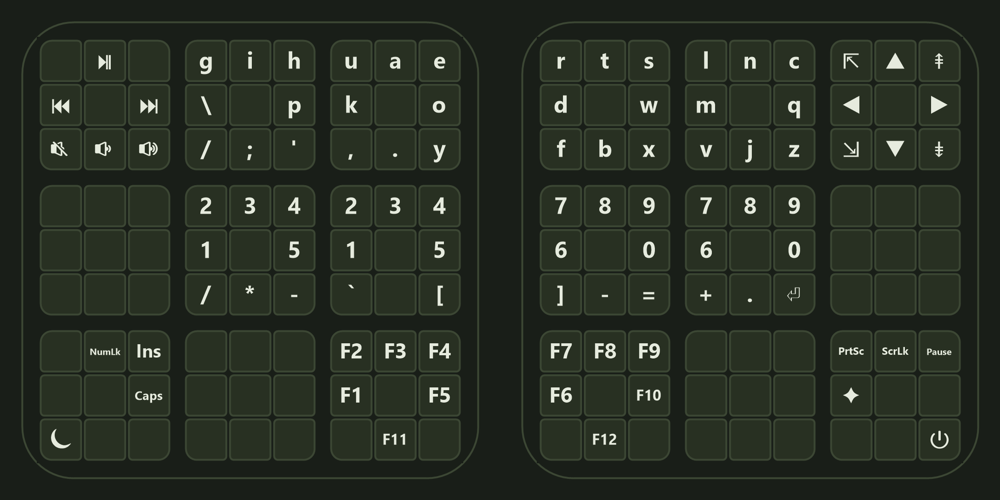

# LizardKing

**Lizard mode, grown into a complete controller.**

Without Steam, a Steam Controller falls back to lizard mode: a basic mouse
and a few keys, just enough to get you to Steam. LizardKing is firmware for
a small USB puck that replaces Valve's and makes lizard mode the whole
product: a full gamepad, mouse and keyboard, with or without Steam.

- **No Steam needed, but great with it.** Windows sees a plain Xbox
  controller, keyboard and mouse, so it works at the login screen, in admin
  prompts and before Steam starts. With Steam running, the Steam button
  still opens the overlay, and Steam Input can still rebind the gamepad.
- **Gamepad, mouse and keyboard at once.** The sticks and buttons are an
  Xbox pad while the trackpads are a mouse. Rest both thumbs on the pads
  and they type every key a keyboard has. On a table, it's a full trackpad
  mouse.
- **Gyro aiming in any game.** With a thumb on the right pad the gyro
  moves the mouse too, so every game that aims with a mouse gets gyro aim,
  no config needed.
- **One consistent layout.** The same controller on the desktop, at the
  login screen and in games, so what your hands learn holds everywhere.
- **Wake the PC from the couch,** and put it to sleep from the pads.
- **About 3 ms added,** every report polled at 1 ms
  ([docs/LATENCY.md](docs/LATENCY.md)).
- **Carries its own guide.** Hold the Steam button on any PC for the
  LizardKing Guide, which shows the controller live, key under each thumb
  included, until you know it by heart.

Trying it costs an inexpensive nRF52840 board and a drag-and-drop install.
Going back to Valve's puck is a re-pair in Steam.

## How it works

Both thumbs on the pads: keyboard. Anything else: an Xbox gamepad whose
pads are the mouse.

| Button | Controller layer | Keyboard layer |
|---|---|---|
| Right pad / click | pointer with gyro / left click | types |
| Left pad / click | scroll / middle click | types |
| QAM | right click | — |
| A / B | Enter / Esc | — |
| X / Y | back / forward | — |
| L4 / L5 / R4 / R5 (back) | the gamepad's B / Y / A / X | Shift / Ctrl / Win / Alt |
| LT / RT | triggers | Backspace / Space |
| LB / RB | bumpers | Tab / Delete |
| Sticks, d-pad, View, Menu | the gamepad's | — |
| Steam | the Xbox Guide button; held, the LizardKing Guide | chords |

## The keyboard

Every key a keyboard has, on the two pads. It takes a little practice, and
the Guide is there for it.



How it all fits together: [docs/KEYBOARD_LAYOUT.md](docs/KEYBOARD_LAYOUT.md).

## Opinionated on purpose

One layout and one way to do each thing, decided for you: no profiles and
no settings screens.

- Design and behaviour: [docs/DESIGN.md](docs/DESIGN.md)
- Latency: [docs/LATENCY.md](docs/LATENCY.md)
- What's next: [docs/ROADMAP.md](docs/ROADMAP.md)
- Working on the code: [AGENTS.md](AGENTS.md), [CODE_MAP.md](CODE_MAP.md)

## Hardware

A Steam Controller 2 and an nRF52840 board running the Adafruit UF2
bootloader. Tested on a [Pro Micro nRF52840](https://a.co/d/0bRC0sc9), a
nice!nano-compatible clone sold on Amazon by Teyleten Robot (its bootloader
reports itself as a nice!nano). Other boards that [OpenPuck](https://github.com/safijari/openpuck)
supports should work but are untested here.

## Install

1. Download `LizardKing.uf2` from the latest release.
2. Double-tap the board's reset button: a drive appears. Copy the file onto
   it. The board restarts unpaired.
3. Plug the puck and the controller into the PC and, with Steam running,
   pair as you would with Valve's puck. Pair every controller you want now.
4. Unplug the puck and plug it back in: it starts as LizardKing.
5. Hold the controller's Steam button for half a second: the guide drive
   appears. Start `LizardKing Guide.exe` from it to learn the layout.

Lost or replaced a controller? Install again: every install starts unpaired.

Games that should see the Xbox pad directly need Steam Input off for that
game (Properties → Controller → Disable Steam Input).

## Build

Needs [arduino-cli](https://arduino.github.io/arduino-cli/) with the Adafruit
nRF52 core. On Windows the build also embeds the Guide, compiled with the
.NET Framework's own C# compiler.

```sh
make build                # build/out/LizardKing.uf2 and LizardKing-dev.uf2
make flash                # install LizardKing.uf2 on the puck
make flash KEEP_BONDS=1   # the dev UF2: keeps the puck's pairing
make keymap-chart         # redraw docs/keymap.png from the firmware's key map
```

## Credits and licence

LizardKing builds on [OpenPuck](https://github.com/safijari/openpuck), whose
reverse-engineered RF link, bonding and USB groundwork it carries over; see
[NOTICE](NOTICE). Licensed under the AGPL-3.0, as OpenPuck is.
